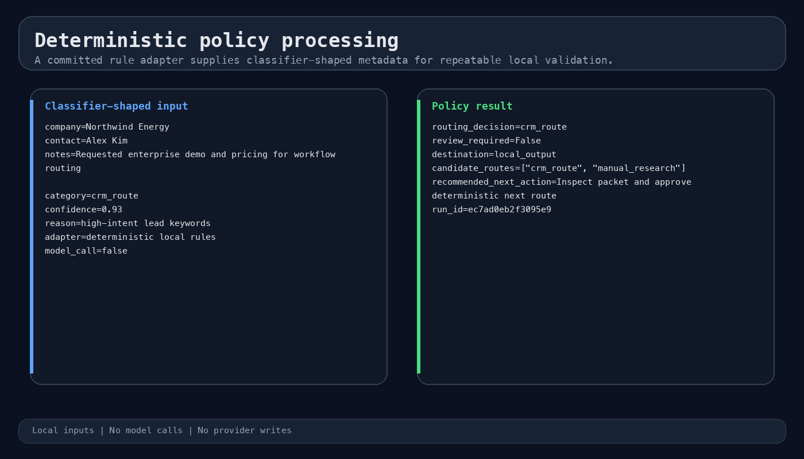

# Human Review Router

Deterministic policy and human-review controls for n8n, Make, Zapier, Python, and API-first automation workflows.

**Status:** an SM Systems reference implementation with reproducible local scenarios.

**My contribution:** policy contracts, review routing, CLI/API interfaces, tests and handover documentation.

[Case study](docs/case-study.md) | [Architecture](docs/architecture.md) | [Local operation](docs/local-operation.md)



*Generated panel from synthetic local scenarios. Further views are in the [image index](docs/screenshots/README.md); recorded totals are separate from current CI.*

## How it works

Human Review Router consumes category, confidence, and rationale fields from an upstream classifier, then applies typed policy to decide whether a workflow can continue or must pause for an operator. The local scenarios use deterministic rule adapters so every route can be reproduced without credentials or provider access.

This repository does not load, host, train, or call an AI model. A production implementation connects an approved upstream classifier at the documented boundary.

1. Validate the workflow contract and incoming payload.
2. Accept category, confidence, and rationale fields from the classifier boundary.
3. Apply deterministic policy to the supplied fields.
4. Continue high-confidence routes that policy allows.
5. Write a review packet when confidence or policy requires an operator decision.
6. Record the selected route, handoff note, and replayable run history.

The CLI and FastAPI interfaces expose validation, execution, replay and queue resolution. Classification metadata comes from an upstream boundary; this code does not load or call a model.

## Usage

```bash
python3.11 -m venv .venv
source .venv/bin/activate
pip install -e '.[dev]'
PYTHONPATH=src python -m review_router.cli list
PYTHONPATH=src python -m review_router.cli validate inbox-triage-router
PYTHONPATH=src python -m review_router.cli run inbox-triage-router \
  --fixture templates/inbox-triage-router/fixtures/sample-input.json
PYTHONPATH=src python -m review_router.cli queue list
```

Local API routes:

```text
GET  /health
GET  /templates
POST /validate
POST /run
GET  /runs/{id}
POST /queue/resolve
```

## Validation

```bash
bash scripts/verify.sh
PYTHONPATH=src python scripts/generate_screenshots.py
PYTHONPATH=src python scripts/generate_screenshots.py --check
```

## Scope and current state

Committed scenarios use synthetic inputs, deterministic rule adapters, and empty credential placeholders. They do not call an AI model or any live external service. No customer data, provider write, cloud resource, public-visibility change, release, or external-sharing action is included.

Production use requires an approved classifier, real identity and access controls, provider-specific credentials, persistent storage, monitoring, and operator acceptance testing.

## Documentation

- [Validation record](docs/validation.md)
- [API contract](docs/api.md)
- [Architecture](docs/architecture.md)
- [Low-code mappings](docs/low-code/)
- [Public-surface checklist](docs/public-readiness-checklist.md)
- [Image index](docs/screenshots/README.md)

MIT. See [LICENSE](LICENSE).
